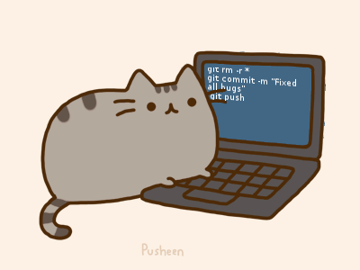

# Hello GitHub Fans 👋

  
  
  

---

## I'm 汪义元

- 😀 一名来自安徽的湖北人（网络安全爱好者）
- 🎓 武汉工程大学 · 电子信息硕士在读
- 🤖 专注 **AI 应用开发、Agent 工作流与多模态 RAG**
- 💻 做过智能招聘 Agent 和知识库问答系统，关注从前端交互到后端流程的完整实现
- 💼 曾在 **国泰新点软件有限公司** 担任 **Agent 实习生**，参与政策知识库相关建设与测试

 

## 🛠️ 技术栈 | Tech Stack

**💻 编程语言** 
     

**⚙️ 后端开发** 
     

**🤖 Agent 与检索** 
       

**🧠 模型与文档** 
          

**🗄️ 数据与存储** 
   

**🌐 前端界面** 
       

**🔌 协议与组件** 
          

**🔧 工程工具** 
       

---

## 🚀 我的项目 | Projects

### 🤖 [智能招聘管理系统 · 招聘 Agent](https://github.com/yuanshen-ai/b2code)

面向 HR 与用人部门，串联 **职位管理 → 简历解析 → 岗位匹配评分 → 人工批准 → 邮件协商 → 钉钉面试日程 → 状态跟进**。

- **简历解析与评分**：PDF 文本提取、扫描件 OCR、结构化信息提取，结合 JD 生成候选人评分与分析。
- **工具调用与流程协商**：Agent 处理候选人回信，查询可用时段、重新协商时间，确认前复查冲突并创建日程。
- **会话与业务状态**：PostgreSQL 保存 Agent 检查点，Redis 管理缓存与邮件游标，配合业务校验和重复操作检查。
- **全栈实现**：FastAPI 后端与 Vue 3 管理界面，覆盖候选人、职位、员工和数据看板。

### 📚 [多模态 RAG 知识库智能问答系统](https://github.com/yuanshen-ai/RAG)

面向设备手册、技术文档等资料，实现 **图文入库 → 查询增强 → 混合检索 → 重排序 → 多轮图文回答与来源引用**。

- **多模态入库**：MinerU 解析 PDF，生成图片摘要与表格转写，关联 MinIO 原文件和图片。
- **查询与检索**：LangGraph 编排意图识别、实体确认和 HyDE 查询增强，使用 Milvus 稠密 / 稀疏向量混合检索。
- **融合与重排序**：RRF 融合两路本地检索结果，与 MCP 联网搜索结果一起进入 Rerank，筛选生成所需证据。
- **交互与评测**：SSE 展示流程进度及回答来源，PostgreSQL 保存多轮会话，并提供 RAGAS 评测脚本。

---

## 💼 实习经历 | Experience

**国泰新点软件有限公司 · Agent 实习生** 
📅 2026.07 – 2026.09

- 参与住房政策知识库的资料整理、解析切片、检索评测与回答核验。
- 核查扫描识别、跨页表格与标题丢失等解析问题，关注政策条款及例外条件的完整性。
- 参与切片策略比较、政策问答样本标注与错误案例复盘，结合来源和引用开展回归检查。

---

> 持续学习 Agent、RAG 与工程实践，让模型能力接上清晰的业务流程。
